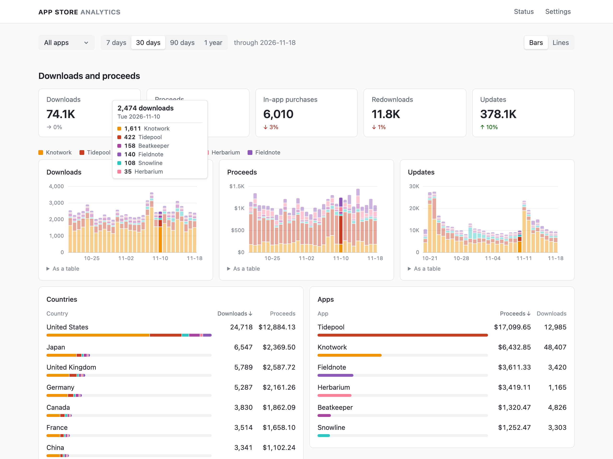
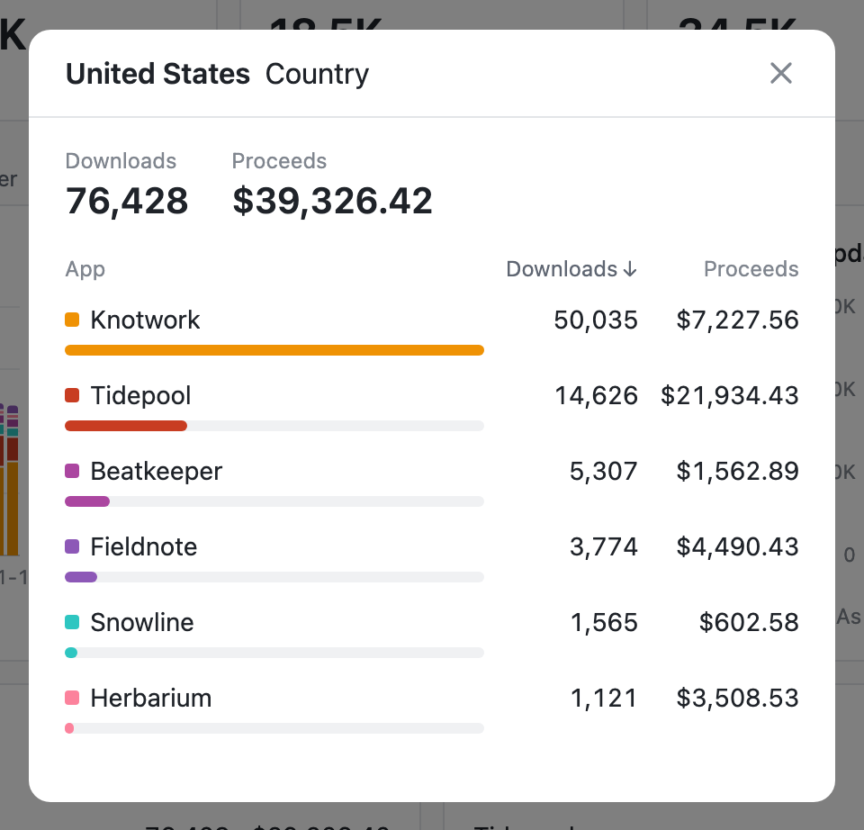
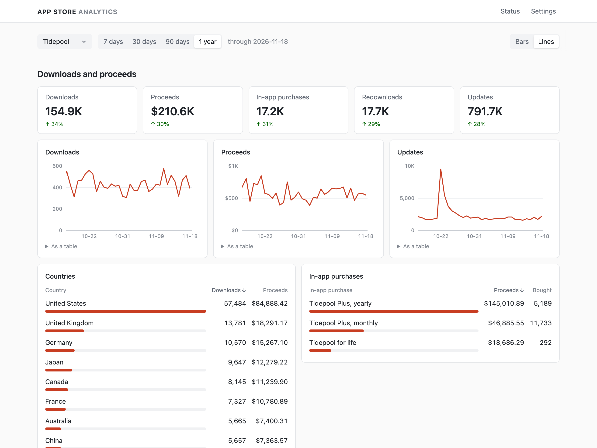
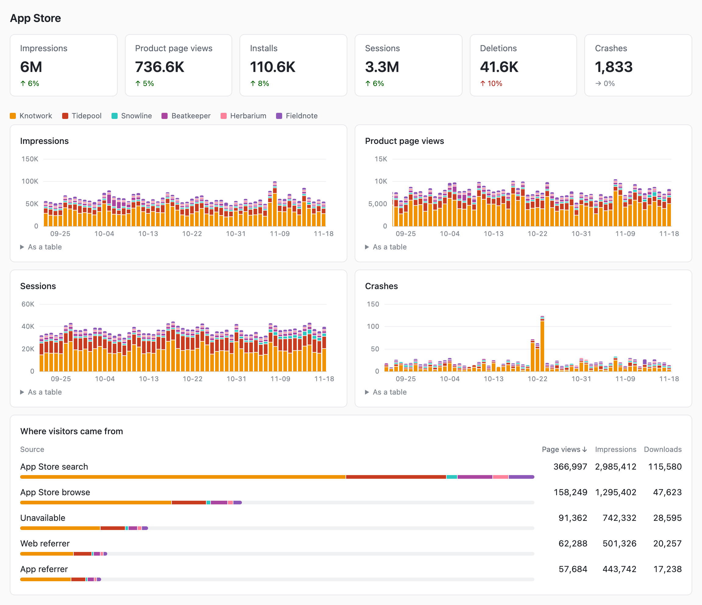
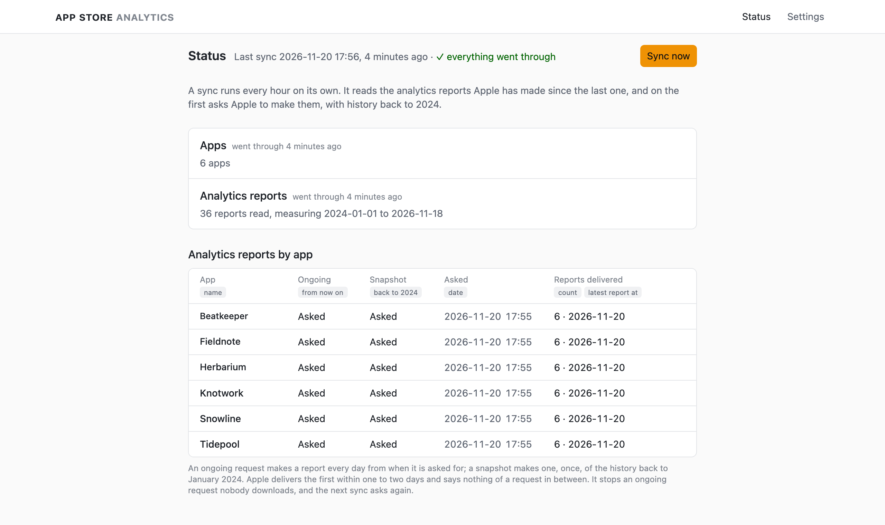
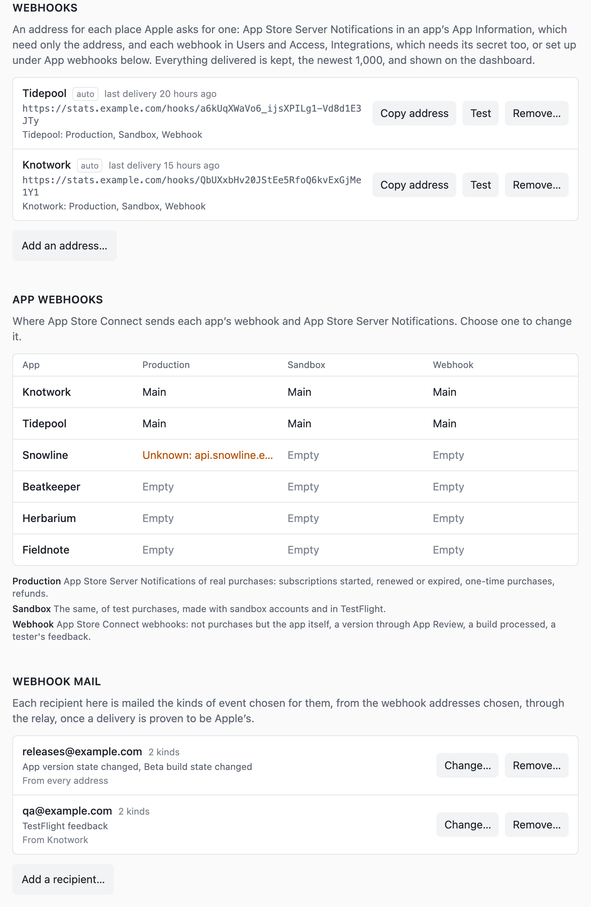
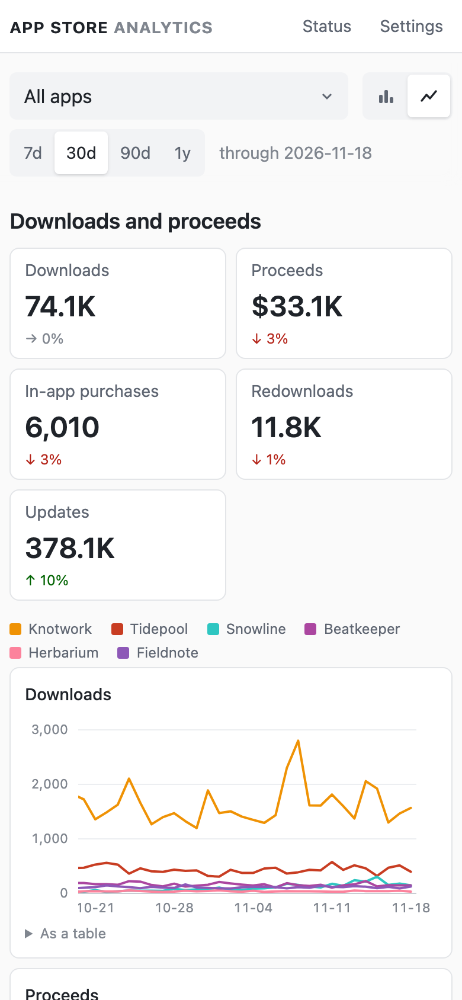

# appstoreanalytics

A self-hosted dashboard of one App Store Connect account: what was downloaded and earned, and
how the App Store pages did. One static binary, one SQLite file, one port.

- **Downloads and proceeds**: first-time downloads, proceeds in US dollars, in-app purchases,
  redownloads and updates, by day, country, app and in-app purchase, against as many days
  before.
- **The App Store**: impressions, product page views, installs, sessions, deletions and
  crashes, by day, and where visitors came from.
- One app or all of them, over 7, 30 or 90 days or a year.
- Everything from Apple's **Analytics Reports API**, which is what Apple points exports at as
  it retires Sales and Trends. Given a vendor number, Apple's **sales reports** fill in
  downloads, purchases and proceeds for the days analytics reports have not reached yet.
- **A sync every hour** reads what is new. The status page says what has been read and what
  went wrong.
- **Apple's notifications and webhooks**: addresses for App Store Server Notifications, of
  purchases, renewals and refunds, and for App Store Connect webhooks, of reviews and builds.
  Each app is connected from Settings, which makes its webhook and points its notifications in
  App Store Connect, and says where each app sends and what is set up wrong. Every delivery is
  kept and checked to be Apple's, and mailed by kind to whoever wants it.
- **One sign-in**, whose username and password are in the environment.
- **Settings**: a mail relay to send through, and every browser signed in, any of which can be
  signed out.
- **Backups** of the whole database, as one file, to a
  [backio](https://github.com/reeywhaar/backio) agent.

## What it looks like

Every app's downloads, proceeds and updates by day, each app in its colour, and a day's apps
under the pointer:

[](docs/screenshots/dashboard.png)

A country's bar opens what each app made there:

[](docs/screenshots/country.png)

One app over a year, as lines:

[](docs/screenshots/app.png)

How the App Store pages did, and where visitors came from:

[](docs/screenshots/store.png)

What the last sync read, and where each app's reports stand:

[](docs/screenshots/status.png)

Webhook addresses, where each app sends, and who is mailed which events:

[](docs/screenshots/webhooks.png)

On a phone:

<a href="docs/screenshots/phone.png"></a>

Invented apps, captured from [the demo](#the-demo) by `npm --prefix web run screenshots`; see
[docs/screenshots](docs/screenshots/).

## Install

### 1. Make a key

In App Store Connect, **Users and Access → Integrations → App Store Connect API → Team Keys**,
generate a key with the **Admin** role, and download its `.p8`. Note the issuer id above the
list and the key's id. See [docs/app-store-connect.md](docs/app-store-connect.md) for what a key
with fewer rights can do.

### 2. Compose it

Behind [caddy-docker-proxy](https://github.com/lucaslorentz/caddy-docker-proxy):

```yaml
# compose.yml
services:
  appstoreanalytics:
    image: ghcr.io/reeywhaar/appstoreanalytics:latest
    restart: unless-stopped
    env_file: .env
    environment:
      APPSTOREANALYTICS_PUBLIC_URL: https://stats.example.com
    volumes:
      - appstoreanalytics-data:/data
    networks:
      - caddy
    labels:
      caddy: stats.example.com
      caddy.reverse_proxy: "{{upstreams 80}}"

volumes:
  appstoreanalytics-data:

networks:
  caddy:
    external: true
```

```sh
# .env
APPSTOREANALYTICS_USERNAME=admin
APPSTOREANALYTICS_PASSWORD=…
APPSTOREANALYTICS_ISSUER_ID=…            # above the list of team keys
APPSTOREANALYTICS_KEY_ID=…               # the XXXXXXXXXX of AuthKey_XXXXXXXXXX.p8
APPSTOREANALYTICS_PRIVATE_KEY_BASE64=…   # base64 -i AuthKey_XXXXXXXXXX.p8 | tr -d '\n'
```

### 3. Start it

```sh
docker compose up -d
```

Sign in at the address. The first sync asks Apple to make each app's reports, and Apple makes
the first a day or two later, with history back to 2024.

## Environment

| variable | | |
| --- | --- | --- |
| `APPSTOREANALYTICS_PUBLIC_URL` | *required* | The address you open in a browser. An https one makes the session cookie `Secure` |
| `APPSTOREANALYTICS_USERNAME` | *required* | The one sign-in, matched without regard to case |
| `APPSTOREANALYTICS_PASSWORD` | *required* | At least 8 characters. Changing it signs every browser out |
| `APPSTOREANALYTICS_ISSUER_ID` | *required* | The team's issuer id |
| `APPSTOREANALYTICS_KEY_ID` | *required* | The key's id |
| `APPSTOREANALYTICS_PRIVATE_KEY_BASE64` | *required* | The `.p8`, in base64 |
| `APPSTOREANALYTICS_VENDOR_NUMBER` | — | Shown at the top of Payments and Financial Reports. Set, sales reports fill in what analytics reports have not said yet |
| `APPSTOREANALYTICS_IAP_KEY_ID` | — | An In-App Purchase key's id, from Users and Access, Integrations, In-App Purchase. Only for a webhook address's Test to ask Apple for a test server notification |
| `APPSTOREANALYTICS_IAP_PRIVATE_KEY_BASE64` | — | That key's `.p8`, in base64. Both or neither |
| `APPSTOREANALYTICS_BACKUP_URL` | — | A backio agent's `POST /backup`. Unset, nothing is backed up. See [docs/backups.md](docs/backups.md) |
| `APPSTOREANALYTICS_DATA_DIR` | `/data` | Where `appstoreanalytics.db` lives. Fixed in the image; a variable for local runs |
| `APPSTOREANALYTICS_LOG_LEVEL` | `info` | `debug`, `info`, `warn` or `error` |
| `APPSTOREANALYTICS_TRUSTED_PROXIES` | `private` | Whose `X-Forwarded-For` names the caller a refused sign-in is logged with: addresses, ranges, `private` or `none`. See [docs/fail2ban.md](docs/fail2ban.md) |

**The environment is checked at startup**, and a container with something missing or malformed
refuses to start, saying which variable and why.

**The data directory is never created.** Mounting it is the statement of where the data lives,
and a forgotten `-v` is a startup error rather than a database that vanishes with the container.
The image declares no `VOLUME` for the same reason.

**The port is `:80` inside the container**, and is remapped with `-p`.

## Running from a checkout

```sh
cd web && npm ci && npm run build && cd ..
mkdir -p data
APPSTOREANALYTICS_PUBLIC_URL=http://localhost APPSTOREANALYTICS_DATA_DIR=data \
  APPSTOREANALYTICS_USERNAME=admin APPSTOREANALYTICS_PASSWORD=… \
  APPSTOREANALYTICS_ISSUER_ID=… APPSTOREANALYTICS_KEY_ID=… \
  APPSTOREANALYTICS_PRIVATE_KEY_BASE64=… \
  go run . serve
```

The bundle is read from `web/dist` at startup rather than embedded, so `go test ./...` and a
checkout that never built the frontend both work; the latter serves a placeholder page.
`npm run dev` in `web/` serves the frontend with reloading and sends `/api` to the Go server on
port 80.

A push to `main` that passes the tests publishes `:latest` and `:v1` to GHCR.

## The demo

```sh
./scripts/run_dev.sh
```

runs it in Docker, built from the checkout, against a stand-in for App Store Connect with six
invented apps and their reports back to 2024. Sign in at <http://localhost:8080> as **demo**,
password **demodemo**. See [dev/README.md](dev/README.md).

## More

- [docs/app-store-connect.md](docs/app-store-connect.md): the key, and what is read from Apple and how.
- [docs/api.md](docs/api.md): the HTTP API.
- [docs/backups.md](docs/backups.md): backups to a backio agent, and when one goes out.
- [docs/fail2ban.md](docs/fail2ban.md): the log lines of refused sign-ins, and a filter for them.
- [docs/conventions.md](docs/conventions.md): how the code is written.
